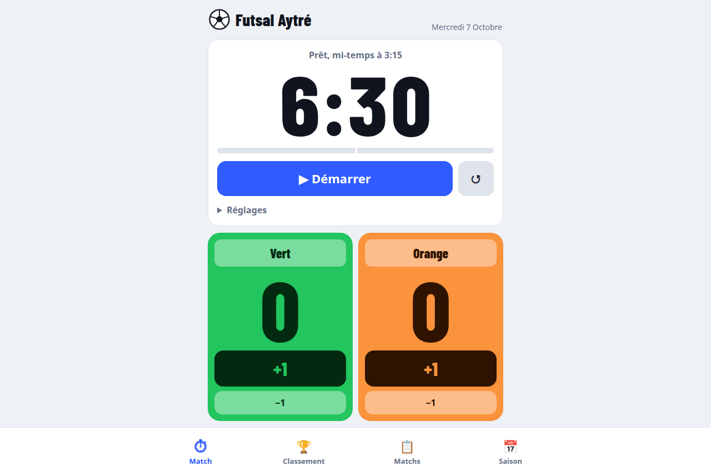
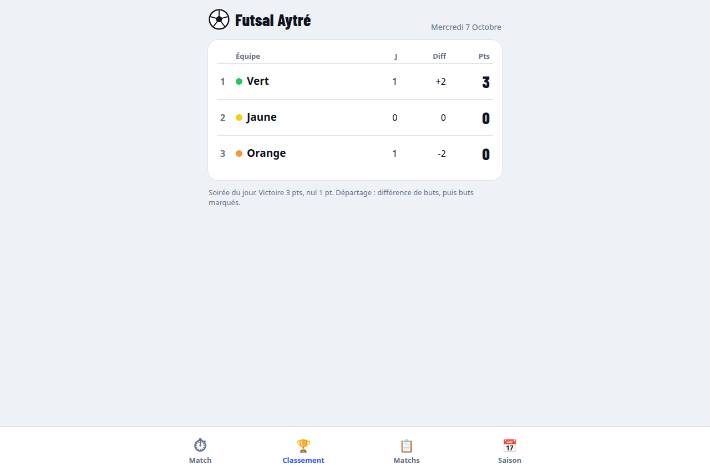
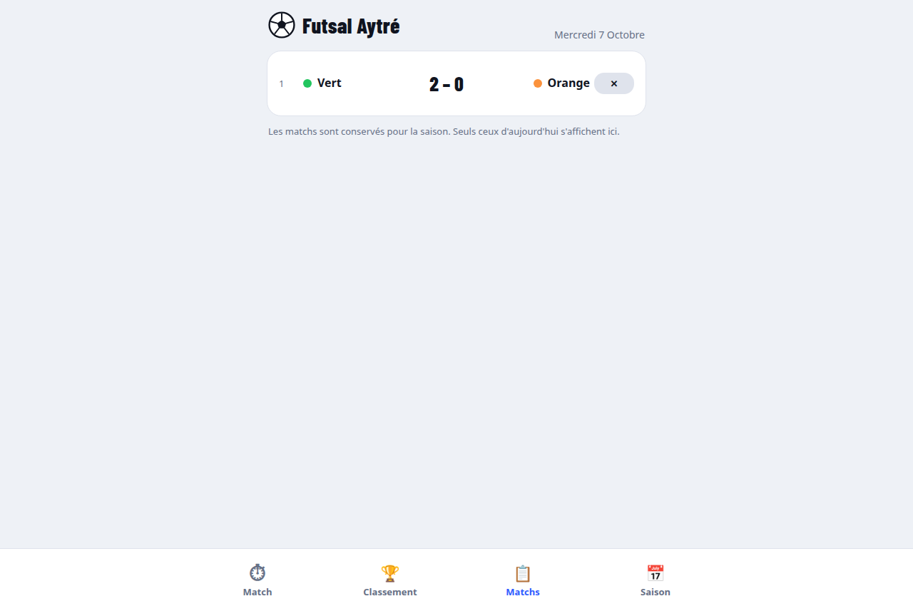
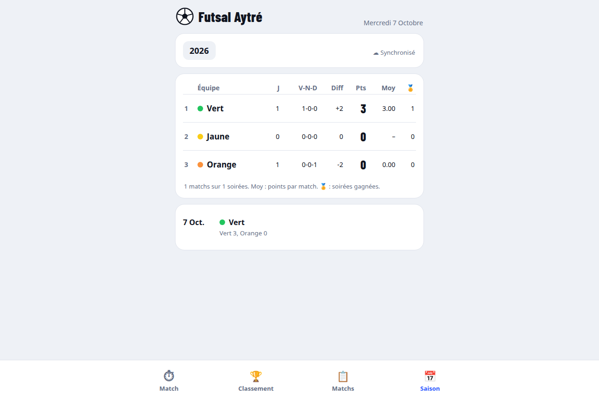

# Futsal Aytré

Application web pour gérer les matchs d'une soirée futsal : chronomètre, scores, rotation des équipes et classement.

[Ouvrir Futsal Aytré](https://futsal-aytre.xaadim.dev)

## Fonctionnalités

- Chronomètre de match configurable avec alertes de mi-temps et de fin.
- Saisie des scores et rotation des équipes après chaque match.
- Classement de la soirée et historique des matchs du jour.
- Statistiques de saison et synchronisation des résultats.
- Comptes joueurs avec code d'activation, rôles admin, niveaux et générateur d'équipes équilibrées.
- Buteur choisi à chaque but ; statistiques personnelles et classements (victoires, buteurs).
- Rotation à 3 équipes : chaque équipe joue 2 matchs sur 3.

## Captures d'écran

### Match

### Classement

### Matchs

### Saison

## Architecture

- Site statique servi par un Worker Cloudflare ; API dans `src/worker.js` (`/api/*`) ; base **Cloudflare D1** (`migrations/`).
- Un seul Worker (`futsal`) et deux bases D1 : **prod** (branche de production) et **dev** (previews des autres branches).
- Aucun identifiant de base dans le dépôt : `scripts/deploy.mjs` lit les variables de build.

## Réglages Cloudflare (Workers & Pages > futsal > Settings > Build)

Variables and secrets :

| Nom | Valeur |
|---|---|
| `D1_DATABASE_ID` | ID de la base **prod** |
| `D1_DATABASE_ID_DEV` | ID de la base **dev** |
| `SETUP_KEY` | clé de votre choix, utilisée une seule fois pour créer l'admin |

Commandes (Settings > Build) :

| Champ | Valeur |
|---|---|
| Build command | *(vide)* |
| Deploy command (production) | `node scripts/deploy.mjs` |
| Deploy command (previews / branches hors production) | `node scripts/deploy.mjs preview` |

Branche de production : `main`. Les autres branches (par exemple `develop`) créent une **Preview** (Worker Previews) liée à la base dev.
URL de test : `<nom-de-la-branche>-futsal.<votre-sous-domaine>.workers.dev` (onglet Previews du Worker).

## Mise en ligne

1. Créer les deux bases D1 et renseigner les variables ci-dessus.
2. Pousser le code : Cloudflare crée les tables et déploie.
3. Ouvrir le site : formulaire « Première installation » (clé `SETUP_KEY` + prénom), puis connexion avec le code affiché.
4. Onglet Joueurs > « Importer l'historique Supabase » (une seule fois), puis transmettre les codes.
